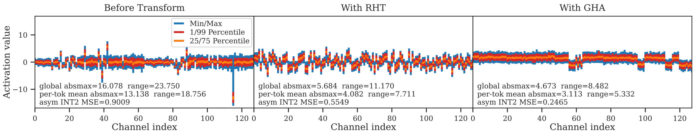
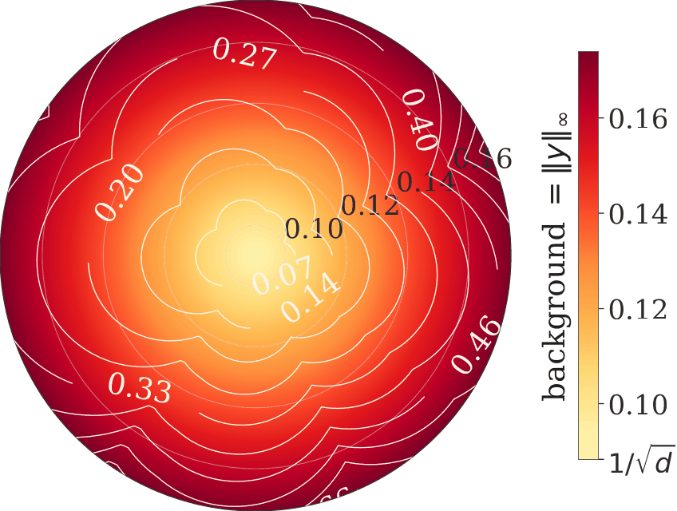

# Greedy Hadamard Alignment for LLM Quantization


This repository contains the official code for [Less Random, More Incoherent: Greedy Hadamard Alignment for LLM Quantization](https://aclanthology.org/2026.aacl-long.70/) (AACL-IJCNLP 2026, **Oral**).

For deployment, see [KVCache Quantization and Offload Library](https://github.com/open-edge-platform/edge-ai-libraries/tree/main/libraries/kv-quant-offload) in Open Edge Platform's edge-ai-libraries. It is a separate 4-bit KV-cache codec for LMCache that quantizes KV chunks as they are offloaded from XPU memory to host memory or disk; its C++ (AVX2 / AVX-512) and SYCL Hadamard kernels take GHA's signs `D` and permutation `P` through an `H·D·P·x` interface.

## Abstract

Hadamard preprocessing is widely used in large language model (LLM) quantization to reduce activation coherence and suppress peaks. Existing methods typically rely on random sign flips before the Hadamard transform, which do not use information from the target data distribution. We propose Greedy Hadamard Alignment (GHA), a simple training-free method to build a signed-permutation preconditioner from calibration data. GHA uses a pooled representative activation, a greedy search over flat targets, and an efficient alignment step that is analytically optimal once the target is fixed. We also study when one shared GHA preconditioner can transfer across LLM activations. GHA works best when activations are directionally aligned and stable across calibration sources. Overall, GHA improves post-quantization model quality over randomized Hadamard baselines, with the strongest gains in KV-cache quantization, more moderate gains for hidden states, and little compute overhead during inference.

<p align="center">
  
</p>
<p align="center"><em>Figure 1: Illustrative pre-RoPE Key distribution from Llama-2-7B (layer 5, head 0)
before transform, with RHT, and with GHA (calibrated using channel-wise medians).</em></p>

<p align="center">
  
</p>
<p align="center"><em>Figure 5: Unit-sphere visualization of GHA's surrogate objective. The contours show
the surrogate (the distance from the Hadamard output y to a flat target), and the heatmap and polar radius show ‖y‖∞.
The two are broadly aligned, so lowering the surrogate tends to lower the peak ‖y‖∞.</em></p>

## Usage

```bash
python3.11 -m venv .venv && source .venv/bin/activate
pip install -r requirements.txt
```

To reproduce Table 1 (RULER-4096) and Table 3 (GSM8K):

```bash
CUDA_VISIBLE_DEVICES=0 bash scripts/table1_gha.sh    # GHA
CUDA_VISIBLE_DEVICES=1 bash scripts/table1_rht.sh    # RHT, direct quantization
CUDA_VISIBLE_DEVICES=2 bash scripts/table1_sota.sh   # DFRot, ButterflyQuant, GSR, MassDiff
CUDA_VISIBLE_DEVICES=3 bash scripts/table3_gsm8k.sh  # GSM8K
python scripts/summarize_ruler_main.py
python scripts/summarize_gsm8k_main.py
```

## Note on pre-RoPE prefill

The paper's pre-RoPE results quantize K/V inside the prefill forward (`--pre-rope-prefill sequential`, the default), whereas deployed systems typically quantize only the cached values after an unquantized prefill (`--pre-rope-prefill independent`). We are running experiments with independent prefill and will update the results soon.

## Citation

```bibtex
@inproceedings{ye-etal-2026-less,
    title = "Less Random, More Incoherent: Greedy {H}adamard Alignment for {LLM} Quantization",
    author = "Ye, Yun  and
      Wu, Zhaoqi  and
      Wang, Xueshu  and
      Zhang, Cong  and
      Yongbo, Zhu  and
      Sun, Zhonghua  and
      XU, Beryl",
    editor = "Zhang, Yue  and
      Xu, Ruifeng  and
      Purwarianti, Ayu  and
      Rong, Tong  and
      Suzuki, Jun",
    booktitle = "Proceedings of the 15th International Joint Conference on Natural Language Processing and the 5th Conference of the {A}sia-Pacific Chapter of the {A}ssociation for {C}omputational {L}inguistics (Volume 1: Long Papers)",
    month = nov,
    year = "2026",
    address = "Hengqin, China",
    publisher = "Association for Computational Linguistics",
    url = "https://aclanthology.org/2026.aacl-long.70/",
    doi = "10.18653/2026.aacl-long.70",
    pages = "1526--1540",
    ISBN = "979-8-89176-439-2"
}
```

## Contact

For questions, please contact the corresponding author, Yun Ye (<yun.ye@intel.com>).
